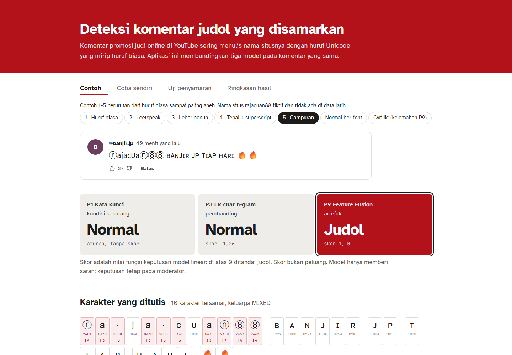
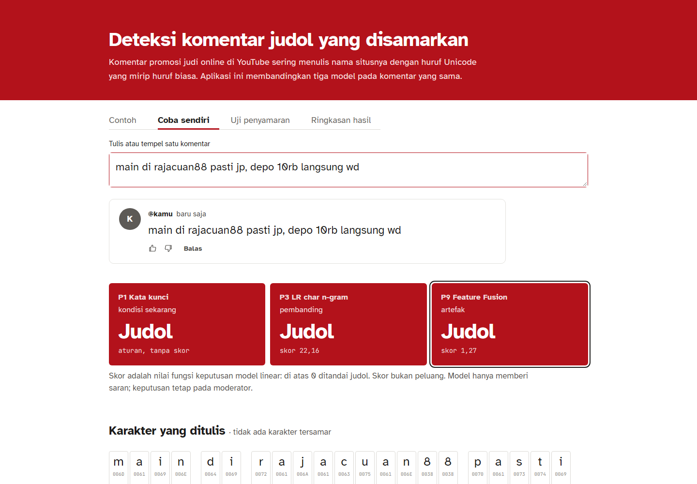
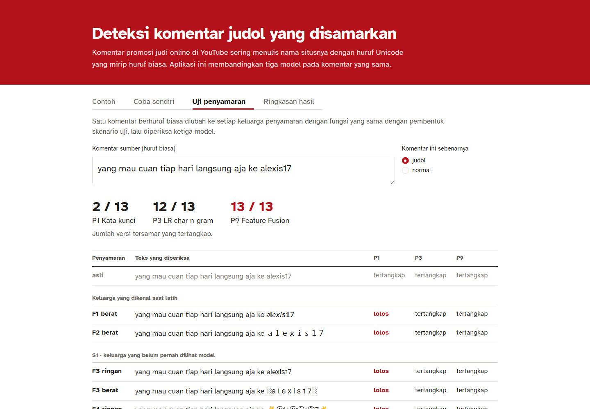
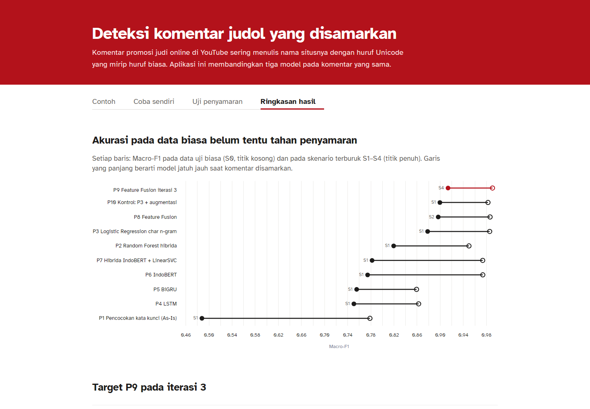

# Judol Detector

Aplikasi daring: **https://judol-detector-qlmrs11.streamlit.app**

- Pipeline penelitian lengkap (Google Colab): https://colab.research.google.com/drive/129fKs5DFibSb4MG7QeIdBZKn37PL98jn?usp=sharing
- Dataset (Kaggle): https://www.kaggle.com/datasets/yaemico/judionline

Aplikasi web untuk mendeteksi komentar promosi judi online (judol) di YouTube yang disamarkan dengan karakter Unicode,
misalnya `ʀᴀᴊᴀᴄᴜᴀɴ88`, `ⓡⓐⓙⓐ`, atau `𝐫𝐚𝐣𝐚𝐜𝐮𝐚𝐧`. Huruf-huruf tersebut tampak seperti huruf biasa bagi manusia,
tetapi berbeda bagi komputer, sehingga filter kata kunci mudah ditembus.

Aplikasi ini membandingkan tiga model pada komentar yang sama:

| Model | Keterangan |
|---|---|
| **P1 Kata kunci** | Pencocokan daftar istilah dan pola nama situs, mewakili cara moderasi yang umum dipakai |
| **P3 LR char n-gram** | Logistic Regression berbasis potongan karakter, pembanding terkuat pada data biasa |
| **P9 Feature Fusion** | Model yang dirancang dalam penelitian ini: normalisasi NFKC, TF-IDF character n-gram, 20 fitur statistik Unicode, dan augmentasi kontrafaktual |

## Isi aplikasi

- **Contoh**: tujuh komentar siap pakai, dari huruf biasa sampai penyamaran paling berat, lengkap dengan putusan ketiga model.
- **Coba sendiri**: tulis atau tempel komentar sendiri untuk diperiksa.
- **Uji penyamaran**: satu komentar diubah ke berbagai keluarga penyamaran Unicode, lalu dilihat model mana yang masih bisa mendeteksinya.
- **Ringkasan hasil**: perbandingan Macro-F1 sepuluh model pada data biasa dan pada skenario penyamaran terburuk, serta status target penelitian.

Setiap karakter komentar ditampilkan beserta kode Unicode dan keluarga penyamarannya, sehingga terlihat bagian mana yang disamarkan.

Model hanya memberi saran penandaan. Keputusan akhir tetap ada pada moderator.

## Tampilan

**Contoh**: komentar tersamar, karakter Unicode-nya, dan putusan ketiga model.



**Coba sendiri**: memeriksa komentar yang ditulis pengguna.



**Uji penyamaran**: satu komentar diubah ke berbagai keluarga penyamaran.



**Ringkasan hasil**: Macro-F1 pada data biasa dibandingkan dengan skenario penyamaran terburuk.



## Menjalankan secara lokal

```bash
pip install -r requirements.txt
streamlit run app.py
```

Gunakan Python 3.11. Versi scikit-learn dikunci karena model hanya dapat dimuat dengan versi yang sama dengan saat pelatihan.

## Asal model dan angka

- `models/p9.joblib` dan `models/p3.joblib` dilatih dengan kode eksperimen penelitian (seed 11) melalui `tools/latih_model.py`.
  Prediksinya identik dengan prediksi seed 11 yang dilaporkan pada penelitian (`models/info_model.json`).
- `src/` berisi kode eksperimen yang dibutuhkan untuk prediksi.
- `hasil/*.csv` berisi tabel hasil eksperimen (rata-rata seed 11, 911, 99).
- `data/confusables.txt` adalah tabel UTS #39 dari Unicode, Inc. (lihat ketentuan penggunaan di kepala berkas).
- Dataset tidak disertakan di repositori ini. Data yang dipakai adalah dataset komentar judi online YouTube dari Kaggle
  ([yaemico/judionline](https://www.kaggle.com/datasets/yaemico/judionline), 10.230 komentar).
- Seluruh pipeline penelitian, dari pembersihan data, pembentukan skenario uji S0 sampai S4, pelatihan semua model,
  hingga evaluasi, dapat dibuka dan dijalankan ulang di
  [Google Colab](https://colab.research.google.com/drive/129fKs5DFibSb4MG7QeIdBZKn37PL98jn?usp=sharing).

## Author

**Qalam**. Aplikasi ini dibuat sebagai bagian dari tugas akhir (skripsi).

Dosen pembimbing: **Arif Rahman Hakim, S.Kom., M.Kom.**
